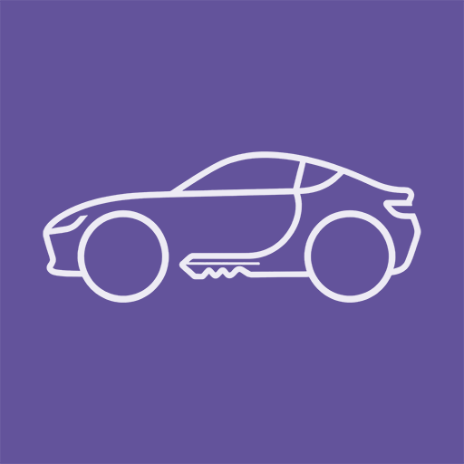
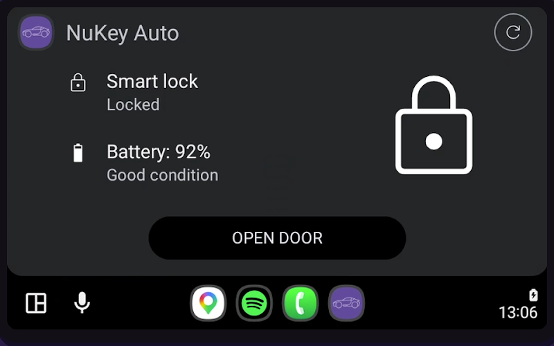
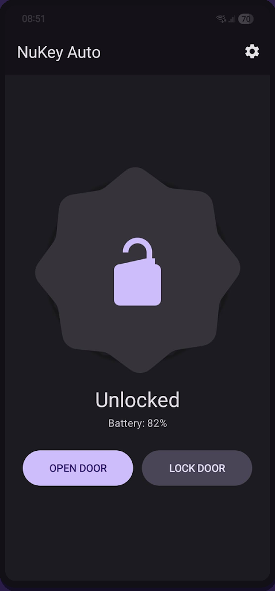
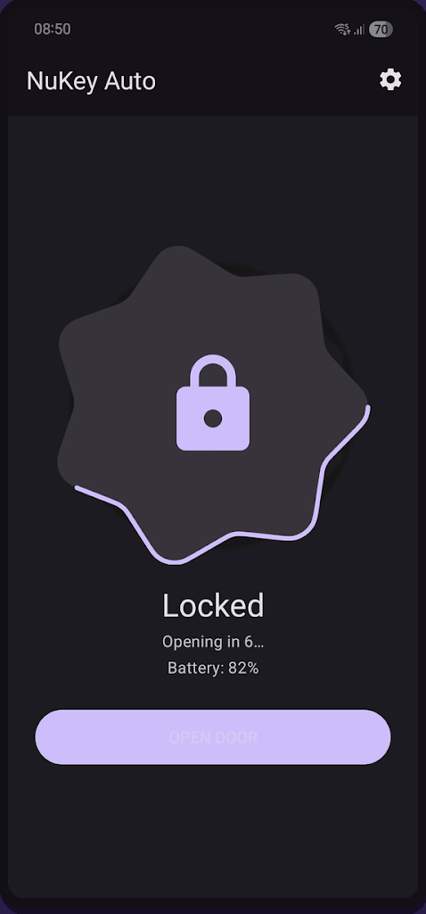
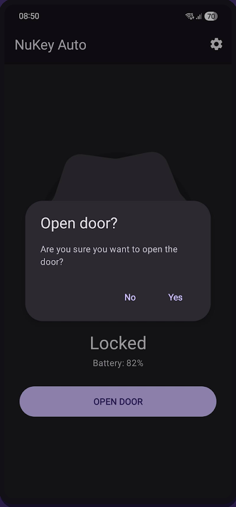

<p align="center">
  
</p>

<h1 align="center">NuKey Auto</h1>

<p align="center">
  Control your Nuki smart lock from Android Auto and your phone.<br>
  Free, open source, no ads, no tracking.
</p>

<p align="center">
  <a href="https://play.google.com/store/apps/details?id=com.ddw.nukeyauto"></a>
  <a href="https://drkdw.github.io/NuKeyAuto/"></a>
  
  
</p>

<p align="center">
  
</p>

<p align="center">
  
  
  
</p>

## Features

- **Android Auto first**: lock status, battery and one clear action on your car screen
- **Safe by design**: optional confirmation and a cancellable countdown before the door opens
- **Phone app**: the same controls as a standalone app, with Material 3, dynamic color and dark mode
- **Private**: no analytics, no tracking; credentials are stored encrypted on the device and only sent to the official Nuki Web API
- **English and Dutch**
- Optional support-the-developer donations via Google Play

## Requirements

- Android 10 (API 29) or higher
- A Nuki smart lock connected to Nuki Web (via a Bridge or the built-in Wi-Fi)
- A Nuki Web API token and your Smart Lock ID, see the [setup guide](https://drkdw.github.io/NuKeyAuto/support.html)

## Build

Open the project in Android Studio and build. Signing credentials are read from `local.properties`, which is not in version control.

```bash
./gradlew assembleDebug
```

Developer documentation lives in [`docs/`](docs): [architecture](docs/ARCHITECTURE.md), [API reference](docs/API_REFERENCE.md) and [roadmap](docs/ROADMAP.md).

## Support

- Questions and setup help: [Support and FAQ](https://drkdw.github.io/NuKeyAuto/support.html)
- Found a bug or have an idea: [open an issue](https://github.com/drkdw/NuKeyAuto/issues)
- [Privacy policy](https://drkdw.github.io/NuKeyAuto/privacy-policy.html)

## License

The source code is licensed under the [GNU General Public License v3.0](LICENSE). You may use, study, change and share it; anything you distribute that is based on it must be released under the same license, with its source code.

The name "NuKey Auto", the app icon and the Google Play listing are not covered by this license. A fork that is published must use its own name and icon.

---

NuKey Auto is not affiliated with Nuki Home Solutions GmbH. Nuki is a registered trademark of Nuki Home Solutions GmbH.
